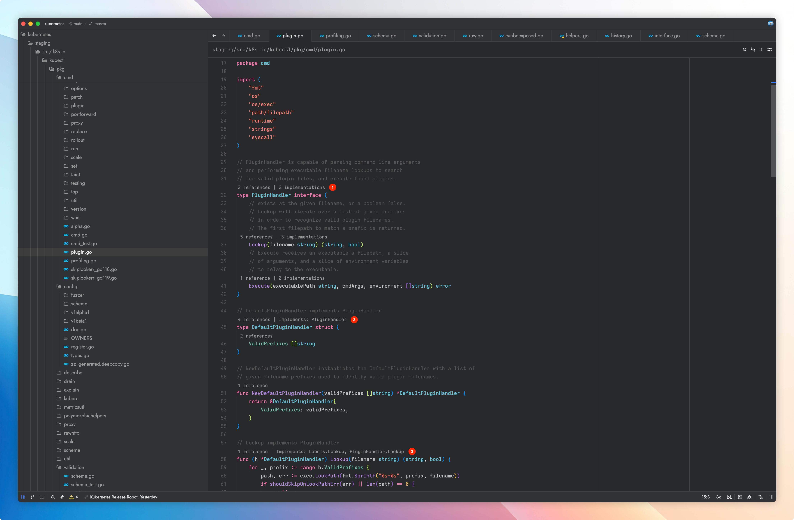

# Go CodeLens for Zed

[English](README.md) | **简体中文**

在 Zed 的 Go 代码中显示符号引用计数与接口实现关系，点击即可跳转。

Go 接口采用隐式实现，因此接口不会列出实现它的类型，具体类型也不会说明自己实现了哪些接口。`gopls` 仍是 Go 的主要语言服务器，但不提供这种关系视图。Go CodeLens 作为独立的辅助语言服务器与 `gopls` 同时运行，只补充引用和实现关系；补全、诊断、格式化、重命名等编辑功能仍由 `gopls` 负责。

本项目受 [Anirudh Agarwal](https://github.com/anirudhagarwal365) 开发的 Visual Studio Code 扩展 [Go Implementation Lens](https://github.com/anirudhagarwal365/go-implementation-lens) 启发。本仓库是面向 Zed 的独立实现，基于 Go 的类型系统。



## 安装开发版本

扩展尚未上架 Zed 扩展仓库，可以先在本地安装开发版本：

1. 安装 Zed 1.14.2+、Go 1.27+、含 `wasm32-wasip2` 目标的 Rust，以及 just 1.56+。
2. 克隆本仓库，然后构建并安装服务器：

   ```sh
   git clone https://github.com/johnny0x38e/go-codelens-for-zed.git
   cd go-codelens-for-zed
   just install
   ```

   服务器默认安装到 `~/.local/bin`，请确保 Zed 能通过 `PATH` 找到它。
3. 在 Zed 中运行 `zed: install dev extension`，选择克隆的仓库目录。

无需额外配置 `language_servers`。如果没有显示 CodeLens，请在 Zed 的 `settings.json` 中启用 `"code_lens": "on"`。

修改扩展后，运行 `zed: rebuild dev extension`。

## 功能

- 在接口、函数和方法上显示 `0 references`、`1 reference` 或 `N references`。
- 在已使用的命名类型、包级变量、常量、命名结构体字段和类型参数上显示引用数量；这些类别中未使用的声明不显示 CodeLens。
- 在命名接口和显式接口方法上显示 `N implementations`，并提供准确的跳转位置。
- 在命名类型上显示 `Implements: Interface`，在接收者方法上显示 `Implements: Interface.Method`；一个声明实现多个接口时会一起显示。
- 支持内部和外部 `_test.go` 测试包。
- 通过最近的 `go.work` 文件（Go 的工作区文件）分析多模块项目；单模块项目不需要工作文件。
- 通过编辑器发送的增量修改，立即分析尚未保存的内容。

接口关系由 `go/types.Implements` 判定，包括指针接收者和提升方法。方法关系要求包、名称和 `types.Identical` 签名一致。引用数量来自 `go/types.Info.Defs` 和 `go/types.Info.Uses`：排除声明位置，合并普通包与测试包中的重复位置，并忽略名称相同但无关的符号。

## 实现方式

```text
Zed
├── gopls                    Go 主语言服务器
└── Go CodeLens 扩展
    ├── src/lib.rs           Rust/WebAssembly 适配层
    └── go-codelens-ls       辅助 CodeLens 语言服务器（独立进程）
```

适配层先在项目的 `PATH` 环境变量中查找 `go-codelens-ls`；找不到时，下载版本匹配的 GitHub Release 文件，用 `SHA256SUMS` 校验后缓存到 Zed 的扩展工作目录。CodeLens 服务器随后找到模块或 `go.work` 工作区，加载一套一致的类型信息，并通过 Language Server Protocol（LSP）返回标准 CodeLens 结果。服务器入口是 `server/cmd/go-codelens-ls`，实现包位于 `server/internal`。

- **结果准确：** 所有关系由 `go/types` 校验；名称索引只用于缩小候选范围。
- **增量分析：** 函数体修改后重新检查拥有该文件的包，API 修改后重新检查依赖它的包，结构或模块变化回退到完整的 `packages.Load`。
- **只读结果：** 更新时只复制变化的数据，读取者共享未变化的 map、slice 和跳转目标；过期结果不会返回。
- **快速编辑：** UTF-8 文本缓冲区和行首索引应用 UTF-16 修改，无需重建整份文档。
- **受控的并发与缓存：** 同一文档版本的请求共享一次分析，无人等待的任务会取消，模块和结果缓存有固定上限。
- **减少磁盘读写：** 只读取打开或修改的文档，以及精确的编译源码路径；默认不写日志、索引或持久缓存。`GO_CODELENS_TRACE` 会记录 LSP 方法调用。
- **稳定与跨平台：** 输出会排序、去重，并使用 LSP UTF-16 位置；CodeLens 服务器构建时不需要 C 编译器，支持 macOS、Linux、Windows 的 arm64 和 x86-64，发布文件经过 SHA-256 校验。

## 性能

在 Apple M1 Pro、Go 1.26.5 上，对未经修改的 Kubernetes 浅克隆（不含完整历史）进行了测试。

| Kubernetes 测试项目                 |                                       数值 |
| ----------------------------------- | -----------------------------------------: |
| 提交                                | `b882c60b4023bdf09264c2d5d30a2cadebc240fb` |
| 检出目录大小                        |                                    395 MiB |
| 受版本控制的 Go 文件（不含 vendor） |                                     13,414 |
| `go.work` 中的模块                  |                                         34 |
| 工作区中的包                        |                                      3,029 |
| 请求 CodeLens 的文件                |                   `pkg/probe/exec/exec.go` |

| 测量项                             |       结果 |
| ---------------------------------- | ---------: |
| 首次完整工作区分析与 CodeLens 请求 |  4m42.692s |
| 同一进程中的缓存重复请求           | 249.958 µs |
| 返回的 CodeLens 数量               |         10 |
| 请求取消后的返回时间               |   4.542 µs |
| 分析器停止所需时间                 |   1.967 ms |
| 进程内存峰值                       |   3.69 GiB |
| macOS 报告的内存峰值               |   6.66 GiB |
| 使用的交换空间                     |          0 |

这是一次观察，不是经过统计采样的基准。首次分析包含全部 34 个模块并启用测试，大部分时间用于首次 `packages.Load`；缓存后的重复请求在微秒级返回，预期的 10 个 CodeLens 全部存在。

`just bench` 运行正确性、竞态、基准、内存分配和性能分析测试；性能分析文件写入 `$TMPDIR`。

## 开发与构建

要求：Zed 1.14.2+、Go 1.27+、含 `wasm32-wasip2` 的 Rust、just 1.56+、golangci-lint。

用 `just install` 构建并安装当前主机的 CodeLens 服务器（默认 `~/.local/bin`；Zed 使用其他目录时设置 `GO_CODELENS_BIN_DIR`）。从扩展仓库安装不需要本地工具：没有 `PATH` 覆盖时，Zed 会下载匹配的可执行文件。

| 命令                                    | 用途                               |
| --------------------------------------- | ---------------------------------- |
| `just build` / `just build linux amd64` | 构建当前主机或指定目标             |
| `just build-wasm`                       | 构建 WebAssembly 适配层            |
| `just install`                          | 构建并安装当前主机的服务器         |
| `just fmt`                              | 格式化 Go、Rust 和 justfile        |
| `just test` / `just race`               | 运行测试 / 竞态检测                |
| `just vet` / `just lint`                | 用 `go vet` 检查 / lint Go 和 Rust |
| `just check`                            | 执行完整的本地验证                 |
| `just bench`                            | 运行测试、基准和性能分析           |
| `just set-version 0.3.3`                | 更新发布版本                       |
| `just check-version`                    | 检查发布版本是否一致               |

`just build [os] [arch] [output]` 接受与构建脚本相同的目标和输出路径；相对路径以仓库根目录为基准：

```sh
just build windows arm64
just build linux amd64 bin/custom-server
```

Windows 下，just 的任务都通过 Git Bash 的 `sh` 执行，因此 `sh` 必须在 `PATH` 中；build 和 install 直接调用 PowerShell 7（`pwsh`），版本检查还需要 `awk`。

支持的发布目标：

| 操作系统 | 架构   | 发布目标标识符              |
| -------- | ------ | --------------------------- |
| macOS    | arm64  | `aarch64-apple-darwin`      |
| macOS    | x86-64 | `x86_64-apple-darwin`       |
| Linux    | arm64  | `aarch64-unknown-linux-gnu` |
| Linux    | x86-64 | `x86_64-unknown-linux-gnu`  |
| Windows  | arm64  | `aarch64-pc-windows-msvc`   |
| Windows  | x86-64 | `x86_64-pc-windows-msvc`    |

`just check` 执行完整验证。任务设置 `GOWORK=off`，临时文件使用 `TMPDIR`/`TEMP`/`/tmp`，`GOCACHE` 默认放在该目录下的 `go-build-cache`（已有的 `GOCACHE` 会保留）。竞态检测设置 `GOMAXPROCS=1`，以避开 `AGENTS.md` 记录的 Go 1.27 `go/types` 问题；`BENCHMARK_OUTPUT_DIR` 可以指定其他输出目录。

`just set-version 0.3.3` 更新 `extension.toml`、`Cargo.toml` 和 `Cargo.lock` 中的版本字段，验证失败时恢复原文件。构建时会注入版本；直接运行 `go build` 或 `go run` 报告 `dev`。CI 在六个目标上运行测试和不需要 C 编译器的构建，在 Linux amd64 上运行竞态检测，并运行 Rust/WebAssembly 检查；版本匹配的 `v<版本>` 标签会发布六个可执行文件和 `SHA256SUMS`，扩展只下载自身版本的文件。

推送 `v<版本>` 标签后，还会通过 [huacnlee/zed-extension-action](https://github.com/huacnlee/zed-extension-action) 打开扩展注册表的更新 PR。需要在仓库中配置名为 `COMMITTER_TOKEN` 的 secret，使用带 `repo` 和 `workflow` 权限的经典 GitHub personal access token。它只负责创建 PR，合并仍由维护者审核决定；该自动化会在扩展被 `zed-industries/extensions` 接受后生效。

## 当前 Zed 限制

- 截至 Zed 1.16.2，点击包含多个目标的 CodeLens 总会打开 Zed 的 multibuffer；这条路径不读取 `lsp_results_location`，因此 `"picker"` 不影响 CodeLens 点击。通过 Zed 导航仍可使用 picker，例如在符号上 cmd+点击，或为 `editor: find all references` 绑定 `"open_results_in": "picker"`；让 CodeLens 点击进入 picker 需要 Zed 本身支持。
- CodeLens 字体由 Zed 编辑器设置控制；LSP 和扩展 API 不支持为单个 CodeLens 设置字体。
- Zed 扩展 API 不提供 VS Code 扩展的自定义 gutter 装饰或树形侧边栏；关系数据通过可点击的 CodeLens 显示。
- 选定模块或 `go.work` 工作区之外的依赖会参与类型信息解析，但没有 CodeLens。空接口报告零个有意义的实现。
- 从扩展仓库安装需要同版本的 `v<版本>` GitHub Release，其中包含六个可执行文件和 `SHA256SUMS`；在 Release 创建前，开发副本可以使用 `PATH` 中的 `go-codelens-ls`。

## 许可证

Go CodeLens for Zed 基于 [MIT License](LICENSE) 开源。
